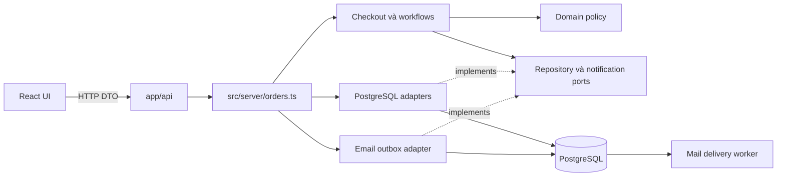

# Kiến trúc hiện tại — cập nhật 11/11/2026

Ứng dụng là modular monolith Next.js/PostgreSQL. Các module **orders, catalog, auth, production và print-requests** có ranh giới domain/use case/repository/composition ở mức độ khác nhau; điều đó không đồng nghĩa toàn bộ roadmap hoặc production readiness đã hoàn tất. Xem [cấu trúc mã nguồn](cau-truc-ma-nguon.md) để tìm các điểm vào theo chức năng.

## Bố cục thư mục và mức độ áp dụng

```text
app/                         Next.js pages, layouts và HTTP routes mỏng
src/
  components/<feature>/      UI theo checkout, admin, catalogue, print-request, lab...
  config/                    Nội dung thương hiệu và cấu hình ứng dụng
  context/                   State phía trình duyệt
  contracts/                 DTO HTTP dùng chung; không chứa DB row
  domain/<module>/           Policy/model thuần, không I/O
  hooks/                     Tương tác tái sử dụng phía client
  integrations/notifications/ Email và Telegram adapters/outbox
  integrations/production/   Adapter AI bị giới hạn theo tool
  lib/                       Database, session, validation và tiện ích nền
  repositories/               SQL đọc/ghi và ánh xạ row
  server/                     Composition root phía server
  services/<module>/          Use case của catalog/orders/auth/production/print-requests
  styles/                     CSS chung
  workers/                    Web Worker chạy trong trình duyệt
database/migrations/          Schema triển khai có checksum
scripts/                      Migration, worker, kiểm thử và vận hành
public/                        Hình ảnh và mô hình 3D
```

Ranh giới hoàn chỉnh nhất nằm ở `orders`, `catalog` và `auth`. `production` và `print-requests` cũng tách use case/ports khỏi SQL và ghép adapter qua `server/`; các module này còn cần tiếp tục chuẩn hóa test/observability theo checklist release. Use case chỉ phụ thuộc domain/contracts, các port và lỗi ứng dụng; SQL ở repository, crypto/email/LLM ở integration, cấu hình và adapter thật được ghép trong `server/`. Guard kiểm mọi thư mục `services/<feature>/`, cấm I/O/cấu hình ngầm và import adapter trực tiếp, đồng thời kiểm đường import bắc cầu từ client và chu kỳ runtime. `lib/auth-session.ts` là adapter HTTP/cookie gọi composition phía server. Các facade service cũ không còn caller đã được gỡ; code mới dùng composition và contracts trực tiếp.

## Module đơn hàng đã triển khai



| Vị trí | Trách nhiệm |
| --- | --- |
| `src/contracts/` | Kiểu request/response và phân trang; DTO HTTP dùng chung giữa route và browser |
| `src/domain/orders/` | Order/payment models và một policy chuyển trạng thái; không DB/Next/React/environment |
| `src/services/orders/` | Checkout, retry, quyền truy cập, đối soát, port I/O và presenter tương thích |
| `src/repositories/orders/order-read.repository.ts` | Read model, phân trang, ownership/token lookup |
| `src/repositories/orders/` | SQL ghi, khóa DB và ánh xạ DB rows → domain; không quyết định chuyển workflow |
| `src/integrations/notifications/order-email.ts` | Ghi email qua outbox hiện có; không gửi mạng trong transaction |
| `src/server/orders.ts` | Composition: dùng một PoolClient cho repository ghi và outbox trong mỗi transaction; facade trả DTO cũ |

Domain dùng camelCase, DB rows phản ánh schema PostgreSQL, DTO công khai giữ hình dạng API hiện có. Mapper/presenter liệt kê trường rõ ràng, không spread DB row để tránh lộ hash/ghi chú nội bộ khi schema mở rộng. `unitPrice` của client không là nguồn giá checkout. `src/config/site.config.ts` vẫn giữ nội dung marketing; catalogue và giá từng SKU đọc PostgreSQL qua module catalogue.

Port chỉ đặt ở ranh giới I/O. `OrderDependencies.transaction` cấp repository và notification adapter cùng client, giữ thứ tự khóa order → payment và advisory lock của checkout. Exception từ outbox làm rollback cả đơn/lịch sử; replay không tạo thêm đơn hay thông báo. Không cần DI framework, ORM hoặc message broker mới.

## Module tài khoản và email

| Vị trí | Trách nhiệm |
| --- | --- |
| `contracts/auth.ts` | `AuthUser`, dữ liệu đăng ký và kết quả xác minh dùng chung với browser |
| `domain/auth/account.ts` | Identity an toàn, account/session/token types, thời hạn phiên và chuẩn hóa email |
| `services/auth/` | Bootstrap không nâng quyền danh tính cũ, đăng ký/đăng nhập, giới hạn thử, xác minh/reset token và quản lý phiên qua ports |
| `repositories/auth/` | SQL, khóa token/user, kiểm vai trò hiện tại, ánh xạ row nội bộ sang domain |
| `integrations/auth/credentials.ts` | scrypt, token ngẫu nhiên và SHA-256; không đưa credential vào DTO |
| `integrations/notifications/account-email.ts` | Ghi token email vào outbox cùng transaction tài khoản/token |
| `integrations/notifications/payment-email.ts` | Soạn và lưu email thanh toán vào outbox |
| `server/auth.ts`, `server/auth-config.ts` | Ghép PostgreSQL, crypto, cấu hình mail/bootstrap; HTTP routes gọi tại đây |
| `lib/auth-session.ts` | Đọc/thu hồi phiên qua composition, đặt/xóa cookie HttpOnly và authorize role tại HTTP boundary |

Token và phiên chỉ lưu hash; raw token xác minh/reset chỉ xuất hiện trong nội dung email cần gửi. Reset cập nhật mật khẩu, dùng hết token cùng loại và thu hồi phiên trong một transaction. Repository kiểm account active, chưa xóa, token chưa hết hạn và vai trò hiện tại ở mỗi lần đọc session. Cookie và DB dùng cùng thời hạn 12 giờ. Không còn tài khoản/mật khẩu demo hoặc API đăng nhập theo vai trò.

## Tổ chức frontend

`app/` giữ routing và composition. `/admin` gọi `components/admin/AdminWorkspace`, logic xác thực/tab/tải và cập nhật nằm ở `useAdminWorkspace`. `/tai-khoan` gọi `components/account/CustomerAccount`, ghép profile/summary/history/card. Định dạng trạng thái dùng chung tại `lib/order-presentation.ts`; type được kiểm đầy đủ với enum domain. Controller checkout và print-request giữ luồng riêng, dùng hook tải có hủy request cũ.

Preview 3D là phần bổ trợ: kích thước STL còn lấy được từ worker khi WebGL không chạy. Sao chép tóm tắt chỉ báo thành công sau khi Clipboard API xác nhận; lỗi có hướng dẫn thử lại/chọn thủ công. Cơ chế dynamic loading, error boundary, GLB và camera spline được giữ. Các thành phần 3D lớn vẫn cần extraction thận trọng ở lần sau.

## API, quyền và dữ liệu có thẩm quyền

| Endpoint | Actor / điều kiện | Use case và bảng chính | Kiểm chứng |
| --- | --- | --- | --- |
| `POST /api/orders` | Guest hoặc phiên hợp lệ; chỉ VIETQR; server kiểm catalogue/specification | Checkout → orders/items, tracking, payments, Telegram outbox; giá đọc DB | Từ chối COD mới, giá client bị bỏ qua, publication, owner ID, idempotency đồng thời, rollback outbox |
| `GET /api/orders/[orderNumber]` | Owner CUSTOMER hoặc token bí mật còn hạn; không có quyền trả 404 | Read workflow → orders/items/payments, tracking hash | Owner/token sai/đúng, email không nhận quyền sở hữu |
| `GET /api/customer/orders` | CUSTOMER | Read repository lọc customer_id, phân trang và summary toàn bộ đơn | Không nhìn đơn người khác; phân trang và summary toàn bộ lịch sử đã có |
| `POST /api/payments/declare` | Owner hoặc tracking token; đơn còn chờ tiền | Declaration → payment/history/audit/proof/outbox | Token sai, URL proof sai, không downgrade VERIFIED |
| `GET /api/admin/orders`, `/payments` | ADMIN | Read repository, page/filter có giới hạn | Trang ổn định, giới hạn kích thước, lọc phía DB |
| `POST /api/admin/payments/verify`, `/reject` | ADMIN | Workflow + locked repository → orders/payments/history/audit/outbox | Verify đồng thời chỉ một lần; không verify đơn hủy/reject VERIFIED |
| `PATCH /api/admin/orders` | ADMIN, WORKSHOP_OPERATOR, PRINT_OPERATOR theo quyền chuyển trạng thái | Domain policy → locked repository, COD receipt/history/audit cho đơn cũ | Ma trận cạnh, quyền, điều kiện tiền và hoàn tất đơn lịch sử |

Authentication ở HTTP boundary, ownership/tracking ở use case, trạng thái và quyền từng bước ở domain policy. `src/lib/auth-roles.ts` là module thuần dùng chung. Quản trị viên đối soát, xử lý giao hàng và hoàn tất đơn. Quyền chuyển trạng thái trong xưởng được kiểm tra theo từng bước. Retry cùng trạng thái không lặp hiệu ứng. Các nhánh thanh toán xác nhận đúng tiền chuyển PENDING_PAYMENT → CONFIRMED qua use case đối soát, không qua thao tác PATCH tùy ý.

## Trạng thái workflow sản xuất và custom print

Các enum thanh toán/đơn hàng vẫn tách khỏi phiếu và lệnh xưởng. Migrations `009_manufacturing_workflow.sql` đến `015_file_purge_marker.sql` bổ sung revision metadata, BOM, inventory, kiểm kỹ thuật, plan, holds, job/allocation nhiều đơn, event retry, file riêng tư, quote và acceptance bất biến. Migration `001–008` không bị sửa. Test tích hợp hiện xác minh cài mới, chạy migration lặp, nâng cấp từ `008` có order cũ và quyền runtime.

| Luồng | Aggregate / API | Quy tắc đang chạy |
| --- | --- | --- |
| Custom request | `print_requests`, `print_request_items`, `file_assets`; `/api/print-requests`, `/api/print-files` | CUSTOMER sở hữu phiếu/file; reviewer nhận việc theo assignment; yêu cầu không file vẫn ở trạng thái cần bổ sung và chưa phát hành quote |
| Quote / acceptance | `quotes`, `customer_approvals`, `orders`, `payments`; `src/services/orders/index.ts` | Quote có revision/terms/hash/hạn; khách chấp thuận đúng phiên bản thì tạo một đơn đủ số lượng trong cùng transaction, chờ VietQR thủ công |
| Manufacturing metadata | `manufacturing_revisions`, `production_requirements`, `production_inventory`, `production_checks` | BOM ghim vào đơn; published body bất biến; tồn phải được xác nhận; yêu cầu thiếu dữ liệu vào WAITING_DATA |
| Planning / batches | `production_plans`, `production_jobs`, `production_supplies`, `production_holds` | Core tính ràng buộc; ADMIN duyệt; transaction recheck snapshot và mới tạo job/allocation/hold; shared batch giữ scope từng item |
| Actual work | `POST /api/workshop/production` | PRINT_OPERATOR ghi bắt đầu thực tế, QC đạt/hỏng và bàn giao đóng gói; chỉ tiến độ commerce tương ứng sau sự kiện thợ, hold chỉ nhả khi đủ scope |
| AI actor | `production_events`, `production_agent_runs`; `scripts/workers/production-agent.cjs` | Provider chỉ đọc projection metadata đã lọc và đề xuất draft; không có tool duyệt, thanh toán, file, SQL hoặc start máy; cấu hình thiếu thì worker để event chờ |

Private upload dùng root filesystem được cấu hình ngoài `public/` và ngoài build, UUID key, quota, hash, quyền đọc theo owner/assignment và retention. Scanner là executable được cấu hình rõ; STL được phân tích bằng worker nội bộ sau scan, OBJ/STEP chờ kỹ thuật ghi số đo/evidence tại xưởng. `clamscan` không có sẵn trong môi trường kiểm thử này; test dùng scanner fixture và **không chứng minh antivirus thật hoặc storage production đã sẵn sàng**. Không gửi file, tên/path, PII hay giá cho agent.

Adapter AI OpenAI Responses API chỉ bật khi cấu hình provider, model, API key, `ENABLED=true` và `METADATA_AUTHORIZED=true`; `.env.example` để các giá trị đó trống/tắt. Test dùng fixture giả lập giao thức, không gọi provider thật. Chưa có nhà cung cấp/model/key được chọn, nên website hiện hiển thị trạng thái chờ cấu hình và không gửi dữ liệu ra ngoài.

Các migration mới có `CHECK`, foreign key, trigger bất biến, audit/idempotency và grants riêng cho role runtime; không backfill dữ liệu xưởng giả. Dữ liệu thật cần được nhập/xác nhận riêng trước khi planner có thể tạo kế hoạch khả thi. Việc hoàn tiền/hủy đơn đã thu tiền vẫn không có workflow; policy hiện tại chặn hạ cấp đơn thay vì cho PATCH vượt qua.

## Catalogue — phần M0.1 đã triển khai

`products` giữ tên/mô tả/nội dung hiển thị; `product_variants` giữ SKU/giá/màu/thông số; `product_images` giữ ảnh công khai theo thứ tự. Read repository chiếu trường công khai sang `contracts/catalog.ts`; `server/catalog.ts` áp chính sách hiển thị theo môi trường. Server section dùng `connection()` + Suspense để đọc ở mỗi request, không đóng băng catalogue vào build. API `/api/catalog` phục vụ browser với `no-store`; lỗi DB trả lỗi chung, giao diện có trạng thái chờ/trống/lỗi.

Giỏ lưu ID public/UUID biến thể/số lượng rồi khôi phục bằng catalogue hiện tại; giỏ legacy theo tên màu được hỗ trợ khi chuyển đổi. Giá mô tả từ storage cũ bị bỏ; SKU đã xóa/hết hàng không được khôi phục. Khi API lỗi, storage cũ được giữ để thử lại. Checkout nhận UUID biến thể, xác minh thuộc sản phẩm và còn được bán, lấy giá/tên/màu/vật liệu từ DB. Client cũ còn được tra theo slug/màu. Đây là read model và composition đơn giản, không thêm service/port rỗng cho truy vấn.

Migration 005 bổ sung schema, cấp SELECT bảng ảnh cho role runtime có sẵn. Seed JSON chỉ phục vụ cài mới và backfill hiển thị có chủ đích, không được import từ app/src. Không tự đổi APPROVED/PUBLISHED trên DB thật. Migration 006 cấp sequence mã sản phẩm/SKU và revision chống ghi đè. ADMIN dùng API products và trang `/admin/san-pham`: service qua ports, repository khóa product trong transaction, audit/status_history cùng commit. Mọi sửa đổi trở về DRAFT/NEEDS_REVIEW; publish yêu cầu nội dung đủ và xác nhận nguồn gốc có ghi chú. Biến thể bỏ khỏi form được ngừng bán, giữ tham chiếu đơn cũ. Lịch sử khách có phân trang ownership và summary riêng; phí catalogue dùng một policy domain cho cả UI/server.

## Guard kiến trúc và CI

`npm run check` gồm type/lint và `check:architecture`. Guard dùng AST/module resolver TypeScript có sẵn, đọc import, export, alias, require, dynamic import và import type; chặn đường client → server (kể cả qua barrel), vòng import runtime, dependency/config/I/O trong domain/contracts/quote-core, SQL trực tiếp ở route/use case, use case gọi adapter và import nội bộ xuyên module service.

`auth-bootstrap.ts` giữ use case bootstrap riêng; adapter email ghi outbox bằng PoolClient được composition cung cấp, worker thực hiện gửi mạng ngoài transaction. Ngoại lệ có chủ đích: `/api/health` đọc DB để chẩn đoán; quote CLI được dùng Node I/O; use case orders được dùng `node:crypto` để sinh/hash định danh. Guard là kiểm tra kiến trúc tĩnh bổ sung cho review, không phải sandbox bảo mật. Module service mới gọi module khác qua entry point công khai, không qua file nội bộ.

```sh
npm run check
npm run test:unit
npm run test:production
npm run build
```

CI `.github/workflows/quality.yml` dùng Node 22 và PostgreSQL 16 tạm, role migration tách runtime. Workflow chạy các lệnh trên; không gọi mail/Telegram thật hoặc production preflight với dữ liệu giả. Test production tự tạo/xóa DB riêng; không ghi vào DB người dùng. Nguồn action: [checkout v4](https://github.com/actions/checkout/tree/v4), [setup-node v4](https://github.com/actions/setup-node/tree/v4). Kiểm tra local không chứng minh job GitHub đã chạy; cần push/PR mới có run trên GitHub.

## Thanh toán và hàng đợi chế tác — 24/10/2026

`server/payment-config.ts` chỉ cấp tài khoản khi chủ triển khai bật rõ và cấu hình hợp lệ. Use case checkout nhận destination qua port; migration 007 lưu `payments.receiving_account` bất biến cho khoản chờ mới. API chiếu bốn trường công khai, UI lấy snapshot từ server; không backfill tài khoản chưa xác nhận cho khoản cũ. Thiếu cấu hình trả 503 và mọi yêu cầu tạo đơn COD mới bị từ chối; retry idempotency vẫn phục hồi đơn đã tạo. `/api/payments/options` chỉ trả khả năng dùng VietQR, không đưa cấu hình bí mật vào bundle. Nhân viên đối soát thủ công trước khi xác nhận đã nhận tiền.

Checkout ghi cảnh báo Telegram mới vào `telegram_outbox` cùng transaction với đơn, khai báo chuyển khoản hoặc xác nhận admin. `scripts/workers/telegram-deliver.cjs` claim hàng đợi theo lease, gửi sau commit và thử lại tối đa năm lần. Tin chỉ chứa mã đơn, số tiền, phương thức/trạng thái; không có thông tin liên hệ/giao hàng của khách. Giao Telegram là at-least-once nên có thể lặp nếu tiến trình dừng sau khi API nhận tin nhưng trước khi DB ghi SENT.

`GET /api/workshop/orders` tiếp tục dùng read model phân trang và projection riêng: chỉ mã đơn, trạng thái và chi tiết chế tác; không PII/tiền. `/admin/san-xuat` và `/api/workshop/production` bổ sung metadata/BOM, xác nhận tồn, checks, plan approval, job start, QC, packing và custom batches. Chưa có telemetry máy tự động; mọi actual start/QC/bàn giao do người ghi nhận.

Các bước sao lưu và khôi phục nằm trong [hướng dẫn chạy trên VPS](operations/vps-docker.md).
