# ĐỀ CƯƠNG SƠ BỘ XIN Ý KIẾN GIẢNG VIÊN HƯỚNG DẪN

**Đề tài dự kiến:** Đánh giá kiến trúc tải tệp trực tiếp lên đám mây và xử lý theo sự kiện cho quy trình báo giá in 3D quy mô nhỏ  
**Sản phẩm ứng dụng:** MinhLab 3D  
**Sinh viên:** [Họ tên – MSSV – Lớp]  
**Giảng viên hướng dẫn:** [Họ tên]  
**Ngày gửi:** [Ngày/tháng/năm]  
**Trạng thái:** Bản đề xuất để xin góp ý; tên đề tài, phạm vi và phương pháp sẽ chốt cùng giảng viên.

## 1. Tóm tắt một trang

MinhLab 3D là website giới thiệu và bán sản phẩm in 3D, đồng thời tiếp nhận tệp thiết kế để xưởng báo giá in theo yêu cầu. Website hiện đã có giao diện Next.js 14, TypeScript và trải nghiệm 3D. Luồng đơn hàng và thanh toán hiện ở mức nguyên mẫu: dữ liệu đơn được giữ trong bộ nhớ tiến trình; thanh toán VietQR do nhân viên xác nhận. Vì vậy, đề tài sẽ xây dựng và đánh giá một **lát cắt nghiệp vụ có thể vận hành**: khách tải tệp lên, hệ thống phân tích mô hình, tạo báo giá, lưu đơn bền vững và đối soát trạng thái thanh toán.

Trọng tâm nghiên cứu là so sánh **tải tệp qua server ứng dụng** với **tải trực tiếp lên object storage bằng URL có chữ ký**, kết hợp xử lý bất đồng bộ sau khi tệp được tạo. Đề tài đo thời gian, tài nguyên server, độ tin cậy và chi phí với quy mô tương đương 100 đơn hàng/tháng. Sản phẩm đồng thời là minh chứng OOAD qua UML, SOLID, Strategy và Dependency Inversion; là minh chứng Cloud/DevOps qua AWS S3, Lambda, IAM, Terraform, Docker và giám sát chi phí.

**Đóng góp dự kiến:** (1) kiến trúc tham chiếu có thể tái lập cho xưởng in 3D nhỏ; (2) bộ số liệu A/B cùng dữ liệu thô và script phân tích; (3) mô hình OOAD ánh xạ được vào code; (4) nguyên mẫu vận hành với các trường hợp lỗi được xử lý. Đây là **kết quả dự kiến**, không phải kết luận đã được chứng minh.

**Giới hạn đề xuất:** bản 5 tuần ưu tiên STL và FDM. OBJ là phần mở rộng nếu đủ thời gian; STEP cần bước chuyển CAD sang mesh và kiểm chứng riêng. Resin được thể hiện bằng chiến lược báo giá tách biệt, nhưng chỉ công bố độ chính xác khi có dữ liệu thực nghiệm tương ứng. Giao diện tour 3D và doanh thu bán hàng không phải biến nghiên cứu chính.

## 2. Vấn đề, câu hỏi và giả thuyết nghiên cứu

**Vấn đề nghiên cứu:** Với ngân sách dưới 150.000 VNĐ/tháng và khoảng 100 khách hàng đầu tiên, cách tổ chức luồng tải và xử lý tệp nào đem lại thời gian đáp ứng, mức dùng tài nguyên và độ tin cậy phù hợp cho một xưởng in 3D nhỏ?

| Mã | Câu hỏi nghiên cứu | Giả thuyết cần kiểm định |
| --- | --- | --- |
| RQ1 | Tải trực tiếp lên storage thay đổi thời gian hoàn tất và tài nguyên Next.js thế nào so với tải qua Next.js? | Khi kích thước tệp và số upload đồng thời tăng, băng thông/CPU của Next.js giảm; mức cải thiện thời gian đầu-cuối cần đo thực tế. |
| RQ2 | Xử lý theo sự kiện mất bao lâu để tạo báo giá và hoạt động ra sao khi sự kiện trùng, đến muộn hoặc tệp không hợp lệ? | Trạng thái bền vững và idempotency ngăn tạo báo giá trùng; độ trễ p95 có thể đáp ứng ngưỡng do xưởng xác định. |
| RQ3 | Sai số ước lượng vật liệu/giá FDM so với kết quả slicer và báo giá của thợ là bao nhiêu? | Công thức đã hiệu chỉnh cho sai số thấp hơn công thức chỉ dựa vào thể tích hình học. |
| RQ4 | Tổng chi phí dự kiến cho 100 đơn/tháng có phù hợp ngân sách không? | Có thể phù hợp trong điều kiện lưu trữ, lưu lượng, hosting và phí thanh toán được nêu rõ; không mặc định Free Tier bao phủ mọi thành phần. |

**Định nghĩa kết quả:** “Báo giá tự động” là giá nháp hoặc khoảng giá có mức tin cậy; tệp hở, lỗi hoặc thiếu dữ liệu được chuyển cho thợ duyệt. Thể tích mesh không đồng nghĩa với lượng vật liệu FDM vì còn thành vỏ, infill, support và thời gian máy.

## 3. Phạm vi hệ thống và kiến trúc dự kiến

```mermaid
flowchart LR
    A[Khách chọn tệp] --> B[Next.js xác thực và cấp quyền upload ngắn hạn]
    B --> C[Browser tải trực tiếp lên S3]
    C --> D[S3 ObjectCreated]
    D --> E[Lambda kiểm tra và phân tích]
    E --> F[CSDL lưu kết quả và báo giá]
    F --> G[Thợ duyệt khi cần; khách chấp nhận giá]
    G --> H[Đơn hàng và thanh toán]
    H --> I[Webhook đã xác thực hoặc đối soát thủ công]
    I --> J[CSDL xác nhận giao dịch]
    J --> K[Telegram thông báo xưởng]
```

S3 là backend chính để triển khai và đo AWS. `IStorageService` cho phép thay bằng Cloudflare R2 trong thí nghiệm chi phí; không ghi hai bản sao mặc định. `IQuoteStrategy` tách FDM và Resin; `IPaymentProvider` tách VietQR và COD. Webhook là nguồn sự kiện bên ngoài; sau khi đối soát và lưu CSDL, một sự kiện nội bộ mới kích hoạt thông báo Telegram.

**Lưu ý với codebase hiện tại:** tài liệu dữ liệu `MinhLab_database_v2.dbml` quy định thanh toán được nhân viên xác nhận. Việc tự động xác nhận từ webhook là **đề xuất thay đổi nghiệp vụ cần thầy và chủ xưởng duyệt**, không được coi là tính năng sẵn có. Trong lúc chưa có nhà cung cấp dữ liệu giao dịch đáng tin cậy, giữ xác nhận thủ công.

## 4. Phương pháp thực nghiệm

### 4.1. Thiết kế so sánh

- **Nhánh A:** Browser → Next.js Route Handler truyền tiếp dạng stream → cùng bucket S3.
- **Nhánh B:** Browser → API xin URL có chữ ký → upload trực tiếp → cùng bucket S3.
- Hai nhánh dùng cùng tệp, vùng cloud, máy client và mạng. Chạy theo cặp, đảo thứ tự A/B để giảm tác động của mạng và thời điểm.
- Tập mẫu dự kiến: 3 mức dung lượng khoảng 1, 10, 30 MB; mỗi mức 3 tệp; 2 điều kiện mạng; 10 lần lặp cho mỗi tổ hợp. Điều chỉnh số lần sau khi có phép đo thăm dò và dự toán chi phí.
- Tập kiểm tra tính đúng riêng: hình khối có thể tích biết trước, model thực của xưởng, mesh hở, tệp hỏng và một số STEP để đánh giá giới hạn.

### 4.2. Biến đo và cách phân tích

| Chỉ số | Đơn vị/cách đo | Cách báo cáo |
| --- | --- | --- |
| Thời gian upload đầu-cuối | Giây, từ lúc nhấn gửi đến lúc storage xác nhận | Median, p95, khoảng tin cậy 95% |
| Thời gian từ upload đến báo giá | Giây, theo cùng `uploadId` | Median, p95, tỷ lệ thất bại |
| CPU/RAM/băng thông server | Peak và tổng theo lần chạy | So sánh A/B ở 1, 5, 10 upload đồng thời |
| Thời gian và bộ nhớ phân tích | Lambda duration, memory, số tam giác | Theo kích thước và chất lượng mesh |
| Sai số hình học/báo giá | So với vật thể chuẩn, slicer và thợ | MAE/MAPE; số mẫu `NEEDS_REVIEW` |
| Độ tin cậy | Số xử lý trùng, lỗi, retry, báo giá/thông báo trùng | Tỷ lệ trên tổng sự kiện |
| Chi phí/100 đơn | Storage, request, compute, log, hosting/CSDL, đối tác thanh toán | VNĐ và giả định tính toán công khai |

Không dùng số liệu giả lập làm kết quả. Công bố dữ liệu thô đã ẩn thông tin khách hàng, cấu hình phần cứng/phần mềm, thời điểm đo và script tính thống kê. Mọi kết luận chỉ áp dụng cho tập tệp, môi trường mạng và tải đã kiểm tra.

## 5. Phần OOAD sẽ nộp

| Biểu đồ/tài liệu | Nội dung |
| --- | --- |
| Use Case | Khách tải tệp, xem/chấp nhận báo giá, đặt hàng, thanh toán; thợ duyệt tệp/giá và đối soát. |
| Class Diagram | `IStorageService`, `S3StorageService`, `R2StorageService`, `IQuoteStrategy`, `FdmQuoteStrategy`, `ResinQuoteStrategy`, `IPaymentProvider`, repository và domain events. |
| Sequence Diagram | Upload → phân tích → báo giá; webhook/đối soát → cập nhật đơn → Telegram, gồm nhánh trùng và lỗi. |
| Activity Diagram | Quy trình duyệt model và chuyển trạng thái đơn/thanh toán. |
| Tài liệu bổ sung | Yêu cầu chức năng/phi chức năng, quy tắc bất biến, mô hình dữ liệu, ma trận truy vết và bộ kiểm thử. |

## 6. Lộ trình 5 tuần và tiêu chí nghiệm thu

| Tuần | Công việc chính | Kết quả gửi thầy xem |
| --- | --- | --- |
| 1 | Chốt câu hỏi nghiên cứu; khảo sát codebase; xác định trạng thái nghiệp vụ; chọn CSDL; lập tập tệp và ngân sách; dựng Use Case/ERD. | Đặc tả v1, sơ đồ kiến trúc, giao thức đo, danh sách điểm cần phê duyệt. |
| 2 | Upload trực tiếp S3, IAM/CORS/lifecycle bằng Terraform; Lambda phân tích STL; kiểm tra tệp và lỗi. | Demo upload → kết quả hình học; Class/Sequence Diagram v1. |
| 3 | Strategy báo giá FDM/Resin; lưu quote/đơn bền vững; đối chiếu slicer và duyệt thủ công; Docker/CI. | Demo báo giá, bảng quy tắc giá, kiểm thử và Activity Diagram. |
| 4 | Tích hợp VietQR theo điều kiện nhà cung cấp; webhook có xác thực/idempotency; Telegram và nhánh đối soát thủ công; thử lỗi/retry. | Demo thanh toán hoặc mô phỏng webhook có ghi rõ; bảng chuyển trạng thái và threat model. |
| 5 | Benchmark A/B; phân tích số liệu và chi phí; sửa lỗi; hoàn thiện UML, bài báo và video demo. | Bài báo 6 trang, dữ liệu thô, mã tái lập, báo cáo chi phí, slide và demo. |

**Điều kiện hoàn thành kỹ thuật:** TypeScript strict, lint, production build và luồng local chạy thành công; đơn hàng không mất sau restart; sự kiện và webhook trùng không tạo bản ghi/thông báo trùng; tệp lỗi không được tự chốt giá.

## 7. Rủi ro, giới hạn và phương án dự phòng

| Rủi ro | Cách xử lý |
| --- | --- |
| STEP cần thư viện CAD nặng và chuyển mesh | Giữ STEP ở nhánh tiếp nhận/duyệt thủ công trong bản 5 tuần; nghiên cứu tự động hóa ở giai đoạn sau. |
| Mesh hở, sai đơn vị đo | Kiểm tra watertight, yêu cầu chọn/kiểm tra mm–cm–inch, từ chối báo giá tự động khi thiếu tin cậy. |
| Giá FDM sai do infill/support | Đối chiếu slicer và thợ; công bố sai số; cho phép hiệu chỉnh và lưu phiên bản công thức. |
| Free Tier hoặc nhà cung cấp thanh toán thay đổi | Chụp cấu hình và bảng giá tại ngày đo; lập ngân sách, cảnh báo, giới hạn tài nguyên và nhánh đối soát thủ công. |
| Dữ liệu khách và tệp thiết kế nhạy cảm | Bucket riêng tư, quyền tối thiểu, thời hạn lưu, dữ liệu nghiên cứu ẩn danh; không đưa tệp gốc vào bộ dữ liệu công khai nếu chưa được phép. |
| Phạm vi quá lớn trong 5 tuần | Ưu tiên STL + FDM + S3; R2, Resin định lượng và STEP tự động chỉ làm khi lõi đã hoàn tất. |

## 8. Các quyết định mong thầy góp ý

1. **Tên và trọng tâm NCKH:** Thầy thấy nên tập trung vào hiệu năng upload, độ tin cậy xử lý theo sự kiện, hay bài toán báo giá in 3D? Em đề xuất lấy **hiệu năng và độ tin cậy của kiến trúc** làm chính; độ chính xác giá là đánh giá ứng dụng.
2. **Phạm vi OOAD:** Bộ bốn UML trên và một lát cắt nghiệp vụ từ upload đến thanh toán đã đủ yêu cầu môn học chưa? Thầy muốn bổ sung State Diagram hoặc Deployment Diagram không?
3. **Dữ liệu thực nghiệm:** Tập tệp và số lần lặp dự kiến có đủ sức thuyết phục không? Có cần mở rộng thành nhiều mạng/thiết bị hoặc có nhóm đối chứng khác?
4. **Báo giá tự động:** Có nên giới hạn kết quả thành *báo giá nháp cần thợ duyệt* trong bài nghiên cứu để tránh khẳng định quá mức về độ chính xác?
5. **Thanh toán:** Có chấp nhận trình bày webhook như phần triển khai ứng dụng, còn đối soát thủ công là phương án chính cho đến khi nhà cung cấp và điều kiện pháp lý được xác nhận không?
6. **Chuẩn đầu ra:** Thầy muốn nộp bài theo mẫu IEEE 6 trang, mẫu NCKH cấp trường, hay biểu mẫu Euréka cụ thể? Có hạn nộp và các mốc duyệt trung gian nào?

## 9. Tài liệu nền ban đầu

- AWS, [Uploading objects with presigned URLs](https://docs.aws.amazon.com/AmazonS3/latest/userguide/PresignedUrlUploadObject.html) và [S3 Event Notifications](https://docs.aws.amazon.com/AmazonS3/latest/userguide/EventNotifications.html).
- Cloudflare, [R2 Pricing](https://developers.cloudflare.com/r2/pricing/) và [R2 Event Notifications](https://developers.cloudflare.com/r2/buckets/event-notifications/).
- Prusa, [PrusaSlicer: perimeters, infill, material and printing time](https://help.prusa3d.com/article/first-print-with-prusaslicer-3-0-0_1079761?product=prusaslicer).
- payOS, [môi trường thử nghiệm với tài khoản cá nhân](https://payos.vn/docs/moi-truong-test/) và [webhook](https://payos.vn/docs/du-lieu-tra-ve/webhook/).
- Chính phủ, [Nghị định 168/2025/NĐ-CP, Điều 82](https://xaydungchinhsach.chinhphu.vn/toan-van-nghi-dinh-168-2025-nd-cp-ve-dang-ky-doanh-nghiep-119250702175708554.htm). Điều kiện đăng ký và thuế cho hoạt động thực tế cần xác minh riêng trước khi nhận đơn.

---

**Tài liệu đính kèm nên chuẩn bị khi gửi:** (1) đề cương này; (2) đường dẫn repo hoặc video demo 1–2 phút về hiện trạng website; (3) 1 ảnh sơ đồ kiến trúc nếu email không hiển thị Mermaid; (4) thời khóa biểu và hạn nộp do khoa công bố. Không cần gửi mã nguồn toàn bộ nếu thầy chỉ đang duyệt đề tài.
