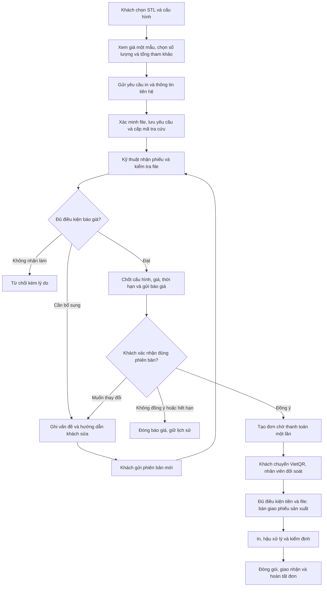
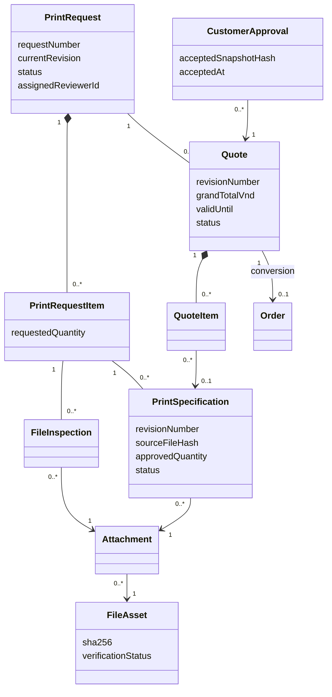
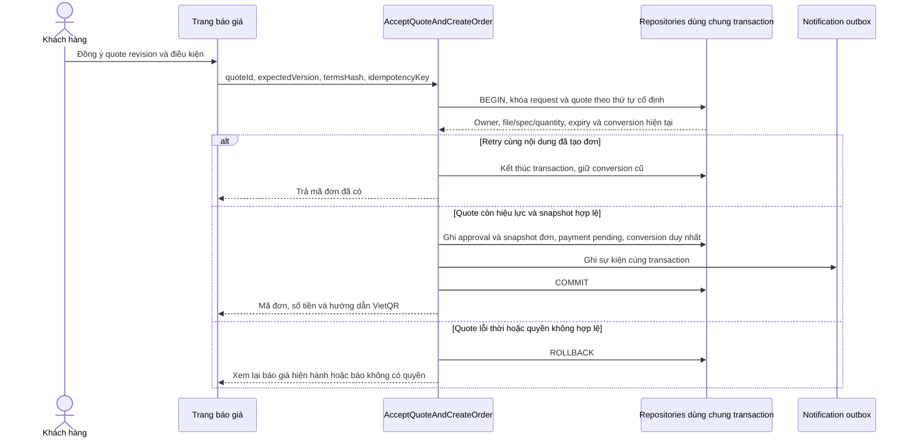

# Thiết kế OOAD — gửi file, duyệt kỹ thuật và đặt in

Ngày thiết kế: 02/11/2026. **Đặc tả giữ vai trò nguồn quy tắc; một phần runtime đã triển khai ngày 11/11/2026.** Phiếu/file riêng tư, assignment/review, quote/acceptance và custom production có API/schema/UI hiện hành. Những đoạn “hiện trạng” dưới đây là mốc khảo sát 02/11, không phải trạng thái code hiện tại. Phạm vi: in theo file của khách; giữ modular monolith Next.js/PostgreSQL, mô hình FDM và thanh toán VietQR đối soát thủ công. Không dùng luồng custom để thay BOM catalogue.

## 1. Mục tiêu và ranh giới hiện trạng

Khách đi từ xem giá tham khảo đến gửi yêu cầu và nhận báo giá rõ ràng. Kỹ thuật có đủ file, số lượng và điều kiện chế tạo để duyệt trên một phiếu; người vận hành nhận đúng phiên bản đã được khách chấp thuận. Mọi quyết định có người thực hiện, thời điểm, phiên bản và lý do.

Tại mốc khảo sát 02/11, `/in-theo-file` đọc STL trên thiết bị và tạo nội dung Zalo/email; chưa có tiếp nhận bền vững hoặc queue duyệt. Từ 11/11, `/api/print-requests`, `/api/print-files` và `/yeu-cau-in` thực hiện luồng riêng; `GET /api/workshop/orders` vẫn là hàng đợi **đơn đang sản xuất/sẵn giao**, không phải queue reviewer. Việc bảng có sẵn trong schema không được xem là bằng chứng; bằng chứng runtime và giới hạn hiện hành được ghi riêng trong ma trận.

Đặc tả này làm rõ luồng custom-print trong E01–E05 của hồ sơ OOAD; không biến sơ đồ thiết kế hoặc bản Draw.io hiện hữu thành bằng chứng triển khai. Không sửa các enum thương mại hiện hành chỉ để khớp nhãn trên giao diện.

## 2. Quy trình chung

Trước khi lưu thành công, giao diện không được báo “Xưởng đã nhận yêu cầu”. File đang upload/xác minh có trạng thái riêng và khả năng thử lại. Mở Zalo, gửi email hoặc ghi tin Telegram không thay thế bước lưu yêu cầu.

## 3. Trải nghiệm khách hàng

| Bước | Khách thấy và thực hiện | Hệ thống chịu trách nhiệm |
|---|---|---|
| Chọn file | STL, hình xem trước, kích thước gốc và đơn vị giả định | Kiểm đuôi/kích thước; giữ phân tích trong worker; lỗi WebGL không chặn phần thông số |
| Chọn nhu cầu | Vật liệu/màu, kích thước mong muốn, mục đích; thông số nâng cao có mặc định và hướng dẫn | Giữ nguyên hình học/tỷ lệ; không bắt khách chọn máy, support hoặc exposure |
| Xem dự đoán | Giá và khoảng tham khảo **một mẫu**, sau đó số lượng 1–100 và tổng | Tổng hiện tại = giá một mẫu × số lượng; không tự suy giảm giá, thời gian mẻ hoặc lợi ích in chung |
| Gửi yêu cầu | Liên hệ, ghi chú, quyền sử dụng file; một nút **Gửi yêu cầu in** | Tự tổng hợp phiếu, upload/xác minh file thật, lưu revision và chống gửi trùng |
| Theo dõi | Mã yêu cầu, trạng thái dễ hiểu, việc cần làm tiếp | Giữ một trang chi tiết và lịch sử; không bắt khách sao chép lại cấu hình qua chat |
| Nhận báo giá | File/phiên bản, cấu hình chốt, số lượng, đơn giá, phụ phí, vận chuyển, tổng, hạn hiệu lực và dự kiến hoàn thành | Chỉ hiện tổng cuối khi các khoản đã xác định; làm nổi bật thay đổi so với mong muốn ban đầu |
| Xác nhận | **Đồng ý báo giá và tạo đơn** hoặc **Yêu cầu điều chỉnh** | Ghi chấp thuận đúng snapshot và tạo một đơn; không thu tiền khi mới gửi yêu cầu |

Không có bước bắt buộc “Tạo bản tóm tắt”. Khối xem lại nằm ngay trên trang; khách chỉ sửa khi cần. Zalo/email phục vụ trao đổi và thông báo, kèm mã yêu cầu/link có kiểm quyền; website là nguồn trạng thái chính.

**Phạm vi MVP tương thích:** xem trước/dự đoán không cần đăng nhập; thao tác gửi, xem file riêng và chấp thuận báo giá dùng CUSTOMER đã xác thực, theo owner hiện có. Đăng nhập tại chỗ hoặc tab riêng phải giữ tab form và File đang chọn; reload có thể cần chọn lại file, không hứa lưu File vào localStorage. Guest gửi/duyệt bằng capability là mở rộng riêng vì `print_requests.customer_id` và `customer_approvals.customer_id` đang NOT NULL; không tạo tài khoản giả hay coi email nhập tay là ownership.

Trường hợp chưa có file vẫn được hỏi tư vấn, nhưng phải hiện rõ “Cần bổ sung file”, chưa duyệt specification/báo giá sản xuất. FDM không ước tính được và resin chuyển sang kiểm tra thủ công; không hiện 0 đồng hoặc chạy mô hình FDM cho resin.

Thông tin giao nhận chỉ hỏi khi cần chốt phí. Trước khi gửi báo giá có tổng cuối phải có đủ dữ liệu xác định phí theo chính sách xưởng; không ghi phí chưa biết là 0. Đổi địa chỉ làm đổi phí thì phát hành revision mới trước khi khách đồng ý.

## 4. Trải nghiệm kỹ thuật: hàng đợi và một phiếu duyệt

**Hàng đợi riêng “Yêu cầu in”**, không dùng chung danh sách sản phẩm catalogue hoặc đơn đã thanh toán. Bộ lọc: Chờ nhận / Tôi đang kiểm tra / Chờ khách bổ sung / Báo giá đã gửi / Đã chuyển đơn / Đã đóng. Mỗi hàng có mã, ảnh/file, số lượng, công nghệ/vật liệu, tuổi yêu cầu, người phụ trách và cảnh báo. Thời gian khách mong muốn khác ngày xưởng đã xác nhận; chưa có SLA thì hiển thị tuổi chờ, không tự hứa 15–30 phút.

Mặc định xử lý yêu cầu chờ lâu trước; yêu cầu có hạn mong muốn hiện cảnh báo để người điều phối đánh giá. Nhận phiếu bằng thao tác atomic; hai người không đồng thời trở thành người phụ trách. Đây là phân công con người, không dùng lease 60 giây của outbox. Chuyển người xử lý có quyền, lý do và lịch sử; không tự thu hồi một ca đang kiểm file chỉ vì người dùng chưa bấm nút.

Phiếu có ba vùng đọc theo thứ tự:

1. **Đầu phiếu:** mã, revision, trạng thái, người phụ trách, số lượng nổi bật, công việc tiếp theo và các blocker.
2. **File và cấu hình:** viewer + tải STL riêng tư; kích thước X/Y/Z và đơn vị; so sánh hai cột **Khách yêu cầu / Kỹ thuật đề xuất**. Khi đổi scale, vật liệu, màu hoặc dung sai phải thấy ngay phần khác biệt và lý do. Cấu hình máy/support/hướng in ở phần kỹ thuật, không dồn vào form khách.
3. **Kết luận và báo giá:** checklist khả thi, ghi chú cho khách tách ghi chú nội bộ; các dòng số lượng × đơn giá, phụ phí và giao nhận; ngày dự kiến hoàn thành và hạn báo giá. Dự đoán FDM chỉ là dữ liệu hỗ trợ, không tự điền thành giá được duyệt mà không có hành động xác nhận.

Ba hành động chính: **Duyệt kỹ thuật và gửi báo giá**, **Yêu cầu bổ sung**, **Từ chối nhận in**. Lưu nháp tự động có chỉ báo đã lưu; chỉ thao tác gửi chính thức mới thông báo khách. Nháp hoặc giá vốn nội bộ không được chiếu ra DTO khách.

Checklist trước khi gửi báo giá:

- Đúng file/hash/revision; upload và bước kiểm an toàn đã hoàn tất theo cấu hình thực tế. Không giả trạng thái scan thành công nếu chưa có công cụ xác minh.
- Kích thước và đơn vị đã xác nhận; số lượng, vật liệu/màu, yêu cầu độ bền/dung sai/hoàn thiện đủ rõ.
- Máy/profile có thể thực hiện; kỹ thuật xác nhận layout/support và kiểm tra bằng slicer khi cần. Xem trước trình duyệt không thay thế slicer.
- Đã kiểm khả năng cung ứng vật liệu và thời gian xưởng bằng quy trình hiện có. Chưa có inventory/scheduler thì ghi xác nhận thủ công có người/thời điểm, không giả là đã giữ kho/slot.
- Giá, phụ phí, giao nhận, ngày dự kiến và hạn hiệu lực đầy đủ. Các thay đổi so với mong muốn khách có lý do và được khách xem trước khi đồng ý.

Nếu thiếu điều kiện, nút gửi báo giá chỉ rõ thiếu gì; vẫn cho lưu nháp hoặc trả yêu cầu bổ sung. Mỗi lần bổ sung là một revision, không làm mất phần đã kiểm còn hiệu lực; checklist phụ thuộc file/spec đã đổi phải kiểm lại.

## 5. Tác nhân và quyền

| Tác nhân | Trách nhiệm và giới hạn |
|---|---|
| CUSTOMER | Gửi/sửa yêu cầu của mình, đọc báo giá đã phát hành, đồng ý/từ chối, theo dõi và thanh toán |
| FILE_REVIEWER | Kiểm file, chốt specification, soạn và phát hành báo giá; đọc thông tin cần thiết của yêu cầu được phân công; không xác nhận tiền |
| STAFF | Điều phối, trao đổi giao nhận, đối soát VietQR, đóng gói/giao; không tự thay specification được duyệt |
| PRINT_OPERATOR | Nhận file/spec đã chốt, số lượng và phiếu sản xuất; ghi tiến độ/kết quả trong phạm vi được giao; không đọc giá vốn/giá bán/PII hoặc xác nhận tiền |
| ADMIN | Phân công và quản trị; vẫn phải tuân thủ transition guard, revision và điều kiện thanh toán |
| Adapter lưu file, phân tích, thông báo | Cung cấp kết quả/trạng thái; không thay tác nhân chịu trách nhiệm duyệt hoặc xác nhận tiền |

“Thợ duyệt file” là FILE_REVIEWER; “thợ chạy máy” là PRINT_OPERATOR. Một người có thể được xưởng phân công nhiều trách nhiệm, nhưng không mặc định role này có mọi quyền của role khác. Quyền review mới phải bổ sung rõ vào policy/API; hiện tại workshop route chưa cấp FILE_REVIEWER hàng đợi duyệt.

## 6. Use case với điều kiện trước/sau

| ID / use case | Điều kiện trước | Kết quả chính | Ngoại lệ |
|---|---|---|---|
| CP-01 Gửi yêu cầu | Owner hợp lệ, quyền file, số lượng hợp lệ; file sẵn sàng hoặc đánh dấu cần tư vấn/bổ sung | Request + item + revision được lưu; trả mã và link | Upload lỗi giữ draft; retry trả cùng kết quả theo idempotency key |
| CP-02 Nhận và kiểm phiếu | FILE_REVIEWER có quyền, trạng thái chờ và version hiện hành | Gán reviewer; inspection gắn file revision | Đã có người nhận/version cũ trả conflict, không ghi đè |
| CP-03 Yêu cầu bổ sung | Phiếu chưa chuyển thành đơn | Issue có mã, mô tả dễ hiểu và việc khách cần làm; chờ revision mới | Không xóa bản kiểm cũ; thay đổi phải vô hiệu phần duyệt liên quan |
| CP-04 Gửi báo giá | Specification APPROVED, file hợp lệ, đầy đủ chi phí và thời hạn | Quote SENT bất biến + audit + notification outbox cùng commit | Sai tổng/thiếu phí/chưa đủ QC kỹ thuật: chỉ lưu draft |
| CP-05 Chấp thuận và tạo đơn | Owner; quote SENT/current/còn hạn; đúng file/spec/quantity/terms | Approval + Order CUSTOM_PRINT + payment pending + link conversion, trong một transaction | Quote cũ/hết hạn hoặc đã thay file: yêu cầu xem lại; retry không sinh đơn mới |
| CP-06 Đối soát và bàn giao | Nhân viên có quyền đối chiếu giao dịch thực tế | Payment VERIFIED; đơn đủ điều kiện chuyển sang sản xuất | Thiếu/sai tiền hoặc đơn hủy: giữ review theo workflow thanh toán hiện có |
| CP-07 Chế tác và QC | File/spec đúng bản được chấp thuận; tiền đạt policy | Ghi lần in, QC đạt/hỏng và phần thiếu; sẵn giao khi đủ đạt | In lỗi không tự báo hoàn tất/thu thêm tiền; sửa hoặc in lại có ghi nhận |

Use case là mục tiêu của tác nhân, không phải từng nút hay từng bảng DB. Các bước kiểm quyền/revision/giá là hành vi bắt buộc được dùng lại; không dùng `include/extend` để biểu diễn thứ tự thời gian.

## 7. Mô hình đối tượng và phân lớp

| Đối tượng | Trách nhiệm và bất biến |
|---|---|
| PrintRequest / PrintRequestItem | Gom nhu cầu của một lần yêu cầu; số lượng mong muốn, owner, revision hiện hành và người phụ trách |
| FileAsset / Attachment | Nội dung private có hash và trạng thái xác minh; attachment xác định file của item/revision, không dùng tên file làm định danh |
| FileInspection | Kết luận của reviewer trên đúng file revision; issue và ghi chú nội bộ/khách tách biệt |
| PrintSpecification | Cấu hình chế tạo được duyệt theo revision, gồm file hash, kích thước, vật liệu/màu, số lượng và yêu cầu chất lượng |
| ReferenceEstimate | Snapshot dự đoán, model/rate-card version và cảnh báo; không có quyền tạo payment |
| Quote / QuoteItem | Phiên bản thương mại gắn specification, số lượng, từng dòng tiền, tổng, hạn và ngày dự kiến; SENT không sửa trực tiếp |
| CustomerApproval | Owner đã đồng ý đúng quote/spec/file/quantity/terms; bằng chứng bất biến |
| Order / OrderItem / Payment | Snapshot giao dịch hình thành sau chấp thuận; số tiền lấy từ quote được phát hành, không từ trình duyệt |
| ProductionJob / ProductionAttempt / QualityInspection | Phiếu chế tác, từng lần in và QC; không gộp thành trạng thái đơn thương mại |

Quan hệ: Request có nhiều item; item có nhiều revision/file inspections/specifications; Request có nhiều Quote revision; Quote có nhiều QuoteItem; Approval trỏ chính xác một Quote; **mỗi Quote được chuyển thành tối đa một Order** trong MVP. Đổi ý đặt thêm sau đó tạo yêu cầu/báo giá mới, không replay lại quote đã tiêu thụ.

Đây là lớp khái niệm, không phải schema/class TypeScript đã triển khai. Draft có thể chưa có item; submit yêu cầu ít nhất một item, quote SENT ít nhất một dòng hợp lệ và mọi dòng in phải gắn specification APPROVED. `acceptedSnapshotHash` là cách biểu diễn tham chiếu snapshot trong thiết kế; bảng hiện có lưu các snapshot/hashes chi tiết, chưa có cột mang tên này.

Aggregate boundary: Request giữ luồng tiếp nhận/review; Quote giữ snapshot giá và phát hành; Order giữ giao dịch hiện có. Use case điều phối cross-aggregate qua transaction, không để entity gửi email hoặc chứa SQL.

| Tầng OOAD | Thành phần đề xuất | Vị trí khi triển khai |
|---|---|---|
| Boundary | PrintRequestForm, RequestTracking, ReviewQueue, ReviewDetail, QuoteAcceptance | `components/print-request`, trang tài khoản/portal review; DTO trong `contracts/` |
| Control | SubmitPrintRequest, ClaimReview, RequestRevision, IssueQuote, AcceptQuoteAndCreateOrder | `services/print-requests`, `services/quotes`; gọi module orders qua entry point công khai |
| Entity / policy | RequestPolicy, QuotePolicy, Specification, Approval; current OrderPolicy | `domain/print-requests`, `domain/quotes`, `domain/orders` |
| Persistence / integration | Request/Quote repositories, PrivateFileStore, AnalysisRunner, NotificationOutbox | `repositories/`, `integrations/`, composition tại `server/` |

Controller HTTP kiểm shape/phiên, use case kiểm ownership và điều phối, domain kiểm cạnh/điều kiện, repository khóa và ghi SQL. Dùng bảng policy thuần tương tự orders hiện có; không cần tạo một class cho mỗi trạng thái hoặc thêm DI framework.

## 8. Trạng thái và các guard quan trọng

| Đối tượng | Chuỗi chính | Nhánh và guard |
|---|---|---|
| Request | DRAFT → SUBMITTED → UNDER_REVIEW → READY_FOR_QUOTE → CLOSED | NEEDS_REVISION → SUBMITTED; REJECTED/CANCELLED có lý do. CLOSED do chuyển đơn chỉ khi order đã commit, không ngay lúc khách mới đọc/đồng ý trên UI |
| Quote | DRAFT → SENT → ACCEPTED → CONVERTED | SENT → DECLINED/EXPIRED/SUPERSEDED. Accept + conversion được ghi cùng transaction; không để ACCEPTED thành trạng thái treo giữa hai request mạng |
| File | Pending upload → verifying → available | Rejected/failed/chờ kiểm; chỉ file verified được dùng cho specification APPROVED |
| Order hiện có | PENDING_PAYMENT → CONFIRMED → IN_PRODUCTION → READY_TO_SHIP → SHIPPED → COMPLETED | CONFIRMED do đối soát; policy chặn in khi chưa PAID với đơn trả trước. Không tự thêm enum quote/review vào orders |

Các tên trạng thái request/quote/file là thiết kế, cần thống nhất CHECK và mapping khi làm migration; comment schema không tự bảo đảm cạnh chuyển hợp lệ. ACCEPTED là mốc nghiệp vụ/audit trong transaction chuyển đơn; API thành công trả CONVERTED cùng mã đơn.

Quy tắc bắt buộc:

1. Khách đổi file, scale, số lượng, vật liệu/màu hoặc yêu cầu chất lượng sau quote SENT: tạo request revision và supersede quote cũ **cùng transaction**; quay lại review. Quote cũ không còn được chấp thuận.
2. Thợ sửa giá/điều kiện sau SENT: phát hành quote revision mới, ghi lý do và diff; khách phải đồng ý lại. Sau chuyển đơn, thay đổi là amendment của đơn có đồng thuận riêng, không sửa snapshot đã chấp thuận.
3. `validUntil` kiểm bằng giờ server ngay trong transaction accept. Quote hết hạn không tự hủy đơn đã CONVERTED; hạn thanh toán là chính sách riêng, không tự đặt số ngày.
4. Khi gửi/accept đều kiểm version hiện hành, hash file, spec revision, quantity và scope owner. Hai tab hoặc hai reviewer thao tác đồng thời phải nhận conflict/dữ liệu mới, không last-write-wins.
5. Tổng tiền VND nguyên do server tính từ các dòng quote; không lấy `unitPrice`, khối lượng hoặc tổng dự đoán client làm nguồn có thẩm quyền. Không tự thêm giảm giá theo số lượng.
6. Duyệt kỹ thuật không đồng nghĩa khách đồng ý; khách đồng ý không đồng nghĩa đã nhận tiền; QC đạt không đồng nghĩa đã giao khách.

## 9. Sequence chấp thuận báo giá và tạo đơn

Nhánh replay phải kết thúc transaction đọc/khóa trước khi trả kết quả. Delivery worker gửi sau commit; lỗi email/Telegram không tạo lại đơn hoặc hủy chấp thuận. Replay cùng key nhưng khác nội dung trả conflict; key mới cho cùng quote cũng chỉ trả conversion đã có, không thêm đơn.

## 10. Tái sử dụng schema/code và phần còn thiếu

Tái sử dụng `file_assets`, `attachments`, `print_requests/items`, `file_inspections`, `print_specifications`, `quotes/items`, `customer_approvals`, `orders/items/payments`, `status_history`, `audit_logs` và outbox. Không tạo bảng mới trùng khái niệm trước khi rà soát schema.

Các khoảng trống cần schema diff và phê duyệt riêng: upload intent trước hash thật; private object thay cho `secure_url NOT NULL`; request revision/assignment/version; lưu ReferenceEstimate và provenance; quote/spec/approval/conversion constraints; ngày dự kiến; delivery metadata; quyền runtime và index cho queue. Không sửa migration 001–008 đã áp dụng, không tự backfill đơn cũ.

**Không nối thẳng form dự đoán vào `POST /api/orders`.** Guard custom hiện tại tìm specification APPROVED, quote ACCEPTED còn hạn và owner, rồi lấy một `quote_item.unit_price`; chưa đủ bảo đảm toàn quote, quantity chốt, phụ phí, approval snapshot và conversion duy nhất. AcceptQuoteAndCreateOrder cần truyền **toàn bộ quote đã xác minh** qua entry point orders, giữ nguyên checkout catalogue. Không xem guard hiện có là luồng custom checkout đã hoàn chỉnh.

MVP đơn custom trả trước toàn bộ, phù hợp policy đang yêu cầu PAID trước in; chưa mở deposit/COD mới dù schema có cột tương ứng. Nhân viên đối soát VietQR theo luồng hiện có; thông báo nội bộ chỉ chứa mã/trạng thái/link an toàn, không gửi file private, contact hay capability token ra nhóm Telegram.

File tải qua authorization và URL ký ngắn hạn; không public theo tên/hash. Retention và hạn quote/payment lấy cấu hình được xưởng chốt, không tự bịa. Rate limit nguồn đáng tin, hạn upload, quota và worker retry hữu hạn là điều kiện trước public.

## 11. Truy vết và tiêu chí nghiệm thu

| Yêu cầu | Use case / đối tượng | Bằng chứng phải có khi triển khai |
|---|---|---|
| Khách gửi một lần và nhận mã | CP-01, Request/FileAsset | Retry/double click chỉ một yêu cầu; upload thất bại không báo đã nhận |
| Thợ đọc và nhận việc rõ ràng | CP-02, assignment/inspection | Hai reviewer claim đồng thời một người thắng; projection đúng role, không lộ ghi chú/PII |
| Khách sửa đúng phần có vấn đề | CP-03, revision | File/số lượng mới vô hiệu quote cũ; diff rõ, inspection cũ còn truy vết |
| Giá chính thức có căn cứ | CP-04, Spec/Quote | Không phát hành thiếu phí/thời hạn; server tính tổng; dự đoán không thành giá có thẩm quyền |
| Khách chỉ chấp thuận bản đang thấy | CP-05, Approval/Order | Test sửa giá/file đồng thời, hết hạn ở thời điểm accept, owner khác, terms cũ, retry/key khác và rollback outbox |
| Không in khi chưa đủ điều kiện | CP-06/07, Payment/OrderPolicy | Duyệt file hoặc ảnh chuyển khoản không mở in; giữ xác nhận PAID theo policy |
| Đúng file và đúng số lượng khi chế tác | CP-07, Job/Attempt/QC | Phiếu vận hành khớp snapshot; hỏng một phần chỉ tạo phần cần làm lại, không coi in xong là giao xong |

UX acceptance: khách không phải hiểu slicer để gửi; chỉ một CTA chính mỗi trạng thái; lỗi cạnh đúng trường; quay lại từ đăng nhập không mất draft đang giữ trong tab; số lượng/giá/diff nhìn rõ trên mobile; hỗ trợ bàn phím; không tràn ngang. Thợ có đủ dữ liệu quyết định trên một màn hình, bộ lọc chờ/tôi xử lý/chờ khách rõ ràng và thông báo lưu nháp không gây nhầm với gửi báo giá.

## 12. Thứ tự triển khai đề nghị tại thời điểm thiết kế

1. Chốt contract và schema diff cho request/file/revision/ownership; chuẩn bị storage private, không thay catalogue/giá/payment rule.
2. Tiếp nhận yêu cầu thật, upload có retry, trang theo dõi và queue/detail cho FILE_REVIEWER; triển khai issue/bổ sung trước chức năng thu tiền.
3. Specification và quote versioned, diff cho khách, expiration và chấp thuận đúng snapshot; nối orders bằng use case transaction có idempotency.
4. Bàn giao read model sản xuất cho PRINT_OPERATOR và luồng QC hiện có; thông báo qua outbox. Các phần job/QC chưa có API phải triển khai và nghiệm thu riêng, không giả đã có vì tồn tại bảng.

Mỗi lát cắt có test và cổng nghiệm thu riêng. Danh sách trên là thứ tự đề nghị tại ngày 02/11. Từ ngày 11/11, các phần file/request/revision/quote/acceptance và custom production đã có implementation với kiểm tra cô lập; scanner/thông báo thật, dữ liệu xưởng, chính sách hủy/hoàn và nghiệm thu staging vẫn mở. Tài liệu này không phải bằng chứng sản phẩm hoàn chỉnh.
