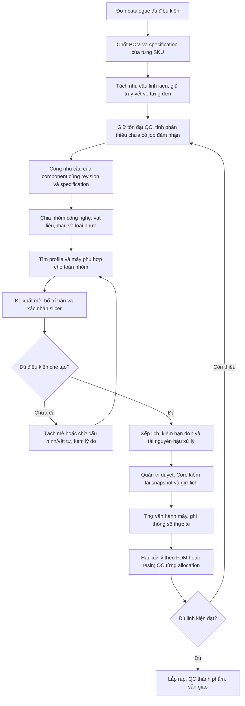

# Khung luồng và điều kiện gom mẻ in catalogue MinhLab

Ngày thiết kế: 29/10/2026. Trạng thái: **đặc tả nghiệp vụ; một phần core/schema/UI đã triển khai ngày 11/11/2026**. Xem [ma trận triển khai](../reviews/implementation-verification-2026-11-11.md). Planner dùng BOM/stock/check/machine data đã xác nhận và hiện lịch FIFO khi chưa có due date; nó không thay thế optimizer toàn cục hoặc xác nhận capacity.

Rà soát Stage 1 ngày 30/10/2026: làm rõ hai cấp gom nhóm và điều kiện máy/profile chung cho toàn mẻ. Các điều kiện này có test domain hiện tại; việc nhập và xác minh dữ liệu thật còn lại.

**Cập nhật quyết định 10/11/2026:** luồng vận hành chi tiết ở [đặc tả agent](production-agent-workflow.md), dữ liệu dùng ở [snapshot không tô vàng](../research/production-agent-data-2026-11-10.md). Người có quyền luôn quyết định duyệt/sửa/từ chối; hệ thống tự cập nhật sau phê duyệt. Máy được giữ đến khi nhóm sản phẩm liên quan chuyển sang đóng gói. Những nội dung về tự áp dụng không có người duyệt trong định hướng 02/11 đã được thay thế. Các ví dụ Black/White/Three Claws bên dưới giải thích thuật toán, không thuộc tập SKU nhập từ workbook lần này.

Định hướng chủ dự án ngày 02/11/2026: AI agent là một tác nhân trong sản phẩm, chủ động chuẩn bị và tối ưu kế hoạch trong phạm vi quyền được cấu hình. Adapter actor/runtime giới hạn đã được thêm; chưa bật provider/model thật, chưa có kế hoạch tối ưu toàn cục, và quyền phê duyệt vẫn thuộc người dùng.

Phạm vi được chủ dự án làm rõ ngày 03/11/2026: tối ưu sản xuất cho sản phẩm thương mại trong catalogue, kể cả mẫu nhận đặt trước. Khi đơn đủ điều kiện theo chính sách đơn hàng/thanh toán, hệ thống lấy đơn làm nhu cầu sản xuất; không gộp yêu cầu in file riêng của khách. Trước khi lập nhu cầu linh kiện, phân bổ thành phẩm đúng biến thể còn tốt cho từng đơn; chỉ phần thiếu mới nổ BOM. Sau đó trừ linh kiện rời đạt QC chưa bị đơn khác giữ và lượng đã có job sản xuất đảm nhận. Nhu cầu linh kiện giống nhau được cộng qua nhiều đơn; các linh kiện khác nhau chỉ ghép cùng mẻ vật lý khi toàn bộ điều kiện máy, vật liệu, màu, profile, bố trí, QC và hạn hoàn tất đều đạt. Kế hoạch luôn giữ phân bổ ngược về từng đơn.

## 1. Dữ liệu đầu vào đã được cung cấp

Không yêu cầu chủ dự án gửi lại thông tin đã có. Những con số kỹ thuật máy/profile chưa ghi được để thành trường cấu hình khi vận hành; không cản việc thiết kế khung.

| Nội dung từ ảnh/trao đổi | Cách biểu diễn |
|---|---|
| B-Daman cấp 1: White, Black, Three Claw(s) | SKU/variant riêng; giữ nguyên ID catalogue hiện có |
| Black và White dùng chung file thiết kế, khác màu | Chung component design/revision, specification màu có thể khác |
| Tay, nắp, đầu của cả ba mẫu dùng chung | Một định nghĩa thiết kế cho mỗi linh kiện thực tế; nhiều BOM cùng tham chiếu |
| Thân và chân Three Claws khác file với Black | Component thiết kế riêng; Black/White dùng nhóm thiết kế chung của chúng |
| Bụng chỉ Black có theo trao đổi trước | Dòng BOM riêng Black; BOM từng SKU độc lập dù có bộ file dùng chung |
| Black và Three Claws dùng cùng loại resin đen theo xưởng | Có thể chung material identity/profile đã xác nhận |
| Thời gian chiếu UV có thể chỉnh trên máy theo trao đổi | Lưu profile dự kiến và thông số vận hành thực tế riêng, có người/thời điểm thay đổi |
| Các lựa chọn FDM, resin đục, resin clear và màu trong ảnh | Là thuộc tính manufacturing specification của SKU, không suy chỉ từ tên sản phẩm |
| Phụ kiện “gawns: 4 món”, giáp có hai loại, free decal | Lưu cấp bộ/phụ kiện trong BOM; decal là bước kitting/hoàn thiện nếu có, không tự coi là linh kiện in |
| Mức giá theo từng dòng và resin 650k/1 lít | Thuộc catalogue/giá vật tư; không là điều kiện quyết định in chung |

Số lượng từng dòng là BOM.quantityPerUnit khi nhập BOM thật, không tự suy “tay” là hai chiếc hoặc tên một nhóm tương đương một file. Đây là dữ liệu cấu hình; công thức và khung luồng hoạt động độc lập với việc nhập ngay con số đó.

## 2. Hai loại gom nhóm phải tách rõ

### A. Cộng nhu cầu linh kiện giống nhau

Ví dụ đầu có cùng component revision và specification, được nhiều đơn dùng: cộng tổng số chiếc cần làm. Vẫn giữ phân bổ về từng order item.

**DemandKey = componentRevisionId + manufacturingSpecRevisionId.**

Spec phải bao gồm các thuộc tính ảnh hưởng khả năng thay thế: vật liệu, màu/loại nhựa, quy cách chế tạo và QC. Profile thay đổi có ảnh hưởng chức năng thì ra spec revision mới; không tự dùng tồn của spec cũ thay spec mới.

Cùng thiết kế nhưng khác màu/spec: dùng chung thiết kế và file nguồn, đồng thời giữ hai nhu cầu sản xuất/kho khác nhau.

### B. Ghép các linh kiện lên cùng bàn in

Một mẻ có thể gồm **nhiều thiết kế khác nhau**: đầu, tay, nắp, thân, chân. Không yêu cầu mọi linh kiện phải trùng file STL, trùng sản phẩm hoặc cùng khách hàng.

**Bucket sơ bộ = technology + materialIdentity + colorIdentity + appearance.**

colorIdentity là màu vật liệu lúc in đã resolve từ BOM/specification, không phải chỉ màu tên SKU hoặc màu thành phẩm sau sơn.

Sau đó kiểm tra giao của tập máy/profile được phép, layout, vật tư, chất lượng và lịch. Component/file/product không nằm trong bucket vật lý vì sẽ loại sai các chi tiết khác thiết kế nhưng có thể cùng mẻ.

Tập profile/máy phải phù hợp **toàn bộ nhóm**. Không chỉ kiểm từng cặp: các cặp có giao chưa chứng minh cả nhóm có một profile/máy chung.

Ví dụ A cho phép `{P1, P2}`, B cho phép `{P2, P3}`, C cho phép `{P1, P3}`. Từng cặp đều có profile chung nhưng `A ∩ B ∩ C = ∅`; không được tạo mẻ A+B+C. Khi thêm một object, phải tính lại giao của toàn candidate, không chỉ so với object cuối.

Profile còn phải được duyệt trên đúng máy/cấu hình máy đó. Biểu diễn mỗi lựa chọn thực thi bằng bộ `(printerId, printerConfigurationRevisionId, profileRevisionId)` rồi lấy giao các lựa chọn được phép của mọi object. `commonProfiles` và `commonPrinters` riêng lẻ chỉ hỗ trợ tra cứu; chúng không chứng minh tồn tại một cặp máy/profile hợp lệ. Giao khác rỗng vẫn phải qua layout, QC, deadline, vật tư và lịch tài nguyên trước khi được duyệt.

Mỗi allocation giữ `requirementId`, `orderItemId`, component revision, manufacturing spec revision và quantity của riêng nó. Mẻ có nhiều DemandKey không làm mất quy cách dung sai, orientation/support, hậu xử lý hoặc kết quả QC riêng của từng object. Các revision là khóa truy vết và thay thế linh kiện, không phải điều kiện bằng nhau giữa mọi object trong mẻ vật lý.

## 3. Luồng nghiệp vụ tổng thể

Các nhánh “chờ cấu hình/vật tư” là trạng thái chờ dữ liệu hoặc thao tác mới, không phải vòng retry tự động vô hạn. Thay đổi nguyên nhân thì engine mới tính lại.

### Bước 1 — Chọn đơn và chốt BOM

- Chỉ item READY_PRODUCT của catalogue, đơn đã được xác nhận đủ điều kiện sản xuất theo policy thanh toán.
- Hàng nhận đặt trước vẫn là sản phẩm catalogue; chỉ đưa vào planner khi đơn đủ điều kiện. Hạn giao đã hẹn cần được lưu theo từng dòng đơn để xếp lịch, không suy từ nội dung mô tả có thể sửa sau này.
- Chọn lượng còn phải đáp ứng; không đưa lại phần đã giao/đã hoàn tất.
- Chốt BOM revision và specification từng dòng để thay đổi sản phẩm sau này không đổi đơn đang làm.
- Không đưa CUSTOM_PRINT của luồng in file khách vào planner này, kể cả khi nằm cùng order.
- Thiếu BOM/spec ở phần nào: ghi BLOCKED_DATA ở phần đó, không tự suy từ tên/màu marketing.

### Bước 2 — Nổ BOM và tính lượng thiếu

Trước hết phân bổ thành phẩm đúng biến thể đã đạt QC, chưa giữ cho đơn khác. Nhu cầu linh kiện của một dòng = số bộ còn thiếu sau bước này × BOM.quantityPerUnit.

Sau khi nổ BOM, chỉ trừ linh kiện rời đúng revision/spec đã đạt QC và chưa bị giữ cho đơn khác. Những linh kiện đã được job duyệt hoặc đang chạy đảm nhận cũng được tính; không tính trùng với hàng đã QC nhập kho.

Các nguồn đáp ứng được theo dõi tách biệt:

- E: lượng đã giữ từ tồn có sẵn.
- G: lượng đạt từ sản xuất được phân bổ cho nhu cầu.
- A: lượng còn do job đã duyệt/đang chạy đảm nhận, chưa nằm trong G.
- N: tổng lượng cần của requirement.

**Q_need_to_plan = max(0, N − E − G − A).**

E/G/A là các lượng rời nhau, không cộng trùng cùng một chiếc sau khi QC nhập kho. Candidate DRAFT chưa được duyệt không được tính vào A. Reservation và ledger xử lý bằng transaction/idempotency.

### Bước 3 — Cộng nhu cầu và phân nhóm

- Cộng theo DemandKey để biết tổng lượng cần của component/spec dùng chung.
- Chia bucket vật lý theo technology/material/color/appearance.
- Tìm commonProfiles và commonPrinters cho cả nhóm.
- Loại phần chưa đủ cấu hình/vật tư; trả reason code cụ thể.
- Sắp EDD với đơn có dueAt; đơn chưa có hạn dùng FIFO và hiện NO_DUE_DATE, không tự bịa deadline.

### Bước 4 — Tạo và kiểm tra mẻ

- Lấy lượng cần thực tế, chia thành một hoặc nhiều candidate.
- Dùng layout template hoặc bố trí bảo thủ trước; giữ orientation/support riêng từng object đã được duyệt.
- Đối chiếu vùng in, khoảng cách, support/raft/brim, chiều cao và clearance của chế độ in.
- Nhân sự kiểm tra bằng slicer phù hợp; lưu file/layout hash, version, profile và thời gian ước tính cho **cả mẻ**.
- Candidate quá đầy/không khả thi: tách nhỏ hoặc in riêng.
- Không lấy thời gian một chi tiết nhân số bản rồi coi là thời gian mẻ đã xác minh.

Theo phạm vi bảo mật chốt 10/11, slicer/layout được kỹ thuật kiểm tra tại môi trường riêng. Core/agent chỉ nhận mã xác nhận và metadata revision, máy/profile, số lượng, thời lượng, người/thời điểm xác nhận; không nhận file 3D, project slicer, G-code, tên/path file thật hoặc link tải. Các yêu cầu bằng chứng/hash ở thiết kế ban đầu không tạo quyền cho agent truy cập file; chi tiết tại [luồng agent](production-agent-workflow.md).

### Bước 5 — Xếp lịch và duyệt

- Xét máy, maintenance, setup/đổi vật liệu, ca nhân sự, tháo mẫu, rửa/đóng rắn resin, QC/lắp ráp.
- So với phương án không gom; giảm setup nhưng không mặc định “gom nhiều luôn nhanh hơn”.
- Trước duyệt, Core kiểm lại revision kho, đơn, job đang chạy và calendar.
- Chỉ người có quyền duyệt mới tạo job/allocation/booking có hiệu lực. AI chỉ nộp đề xuất.
- Nếu thay đổi sau khi gửi đề xuất: STALE_PLAN và tính lại; không âm thầm áp vào dữ liệu mới.

### Bước 6 — Vận hành, QC và in lại

- Thợ khởi động máy thủ công, ghi actual profile/exposure/tiêu hao; hệ thống không gửi lệnh start.
- FDM/resin có routing riêng; rửa/đóng rắn được lên lịch khi quy trình resin yêu cầu.
- QC ghi đạt/hỏng theo component và allocation, không chỉ đánh một trạng thái chung cho cả mẻ.
- Phần lỗi tạo reprint chỉ cho lượng thiếu, có liên kết attempt cũ.
- Đủ linh kiện mới lắp ráp; QC thành phẩm trước READY_TO_SHIP.
- Một đơn hủy không xóa batch chung: giải phóng phần chưa chạy của đơn đó; phần đã chạy xử lý có audit, giữ các đơn khác.

Theo quyết định xưởng 10/11, in xong chỉ kết thúc job in, chưa giải phóng giữ máy. Các job tiếp theo đã duyệt thuộc cùng nhóm sản xuất vẫn được chạy trên máy giữ cho nhóm; máy chưa được giao cho nhóm mới đến khi đủ điều kiện bàn giao đóng gói. Giữ máy có phạm vi allocation và kiểm chống vòng chờ; không đồng nhất với trạng thái vật lý đang in. Xem [trạng thái và cập nhật tự động](production-agent-workflow.md#4-trạng-thái-và-cập-nhật-tự-động).

## 4. Điều kiện in chung

| Mã | Điều kiện bắt buộc / cách kiểm | Khi không đạt |
|---|---|---|
| B01 | Cùng technology; FDM và RESIN tách hoàn toàn | TECH_MISMATCH; tách nhóm |
| B02 | Cùng material identity: formulation/grade/sản phẩm vật liệu được duyệt; không chỉ cùng chữ “resin” hoặc “PLA” | MATERIAL_MISMATCH; tách hoặc chờ spec |
| B03 | Cùng màu thực tế cần chế tạo; cùng appearance/resin đục hoặc clear | COLOR_MISMATCH / APPEARANCE_MISMATCH; tách nhóm |
| B04 | Có ít nhất một profile và máy chung được duyệt cho toàn bộ linh kiện | PROFILE_CONFLICT / NO_COMMON_PRINTER |
| B05 | Printer capability đủ, cấu hình hiện hành được xác minh; đang có slot/availability phù hợp | PRINTER_UNVERIFIED / RESOURCE_UNAVAILABLE |
| B06 | Mọi object, support và khoảng hở nằm trong bàn/chiều cao; không va chạm hoặc vi phạm clearance | LAYOUT_INVALID; chia mẻ/đặt lại |
| B07 | Có đủ vật tư khả dụng cho mẻ theo estimate+buffer được duyệt; kiểm cả material reservation | INSUFFICIENT_MATERIAL; chờ hoặc chia lượng |
| B08 | Profile/layout đáp ứng chất lượng, dung sai, độ bền/bề mặt của từng linh kiện; yêu cầu cách ly được giữ | QUALITY_CONFLICT / QC_ISOLATION_REQUIRED |
| B09 | Thời điểm hoàn tất gồm hậu xử lý còn phù hợp cam kết; không tự làm trễ đơn đang có thể in đúng hạn riêng | DEADLINE_CONFLICT; so mẻ riêng/tách nhỏ |
| B10 | Setup, người thao tác, rửa/đóng rắn/QC đủ slot/capacity, không chỉ có máy in rảnh | POST_PROCESS_CAPACITY / OPERATOR_UNAVAILABLE |
| B11 | Mẻ đã được kiểm tra slicer/layout và có duration/provenance; chưa xác minh thì chỉ là candidate | SLICE_NOT_VALIDATED / ESTIMATE_MISSING |
| B12 | Snapshot và allocation còn hợp lệ, không lấy nhu cầu đã reserve/đã in của plan khác | STALE_PLAN / QUANTITY_CONFLICT |

Các loại phản hồi của engine:

- **CANNOT_GROUP:** mâu thuẫn đã biết, phải tách.
- **WAITING_DATA:** chưa đủ thông tin để xác nhận, chỉ giữ candidate/chờ cấu hình.
- **CANDIDATE:** qua compatibility nhưng còn chờ bố trí/slicer/lịch.
- **VALIDATED_PROPOSAL:** đã kiểm đủ layout, duration, resources và evaluation; chờ người duyệt.
- **APPROVED:** người duyệt và transaction Core đã giữ nguồn lực/tạo jobs.
- **LATE_REVIEW:** cả các phương án khả thi đều trễ; trình độ trễ và tác động để quản trị xử lý, không giả vờ đạt B09.

Một nhóm bị chặn không nhất thiết chặn việc đánh giá các nhóm độc lập khác.

### FDM

Profile chung bao gồm nozzle/layer/process và phạm vi nhiệt/cooling/bed phù hợp. MVP là FDM một màu mỗi mẻ. Không tự đưa AMS/đa màu vào luật khi chưa có capability và quy trình đã duyệt.

Per-object settings chỉ được khác nhau trong phạm vi slicer/máy đã kiểm chứng; vách/infill khác nhau không tự tạo quyền dùng nhiệt hoặc vật liệu khác. Clearance phải theo chế độ by-layer/by-object thật sự được dùng.

### Resin

Cùng nhựa, màu/loại và một profile đã xác minh phù hợp cho cả mẻ. Profile ghi exposure lớp thường/lớp đầu, layer height và các thông số lift/rest/transition cần thiết của máy thực tế; không tự đặt trị số.

Tay/nắp/đầu và thân/chân được xoay/hỗ trợ riêng nếu common profile và layout vẫn hợp lệ. Chỉnh exposure trên máy phải lưu actual override và người chỉnh; nếu override vượt phạm vi đã duyệt, dừng để review, không kế thừa xác nhận khả thi cũ.

Các nguồn của Prusa cho thấy preset resin/exposure và giới hạn layer phụ thuộc vật liệu/máy; số trong tài liệu của họ không được áp cho máy MinhLab chưa xác định. [Tested resins](https://help.prusa3d.com/article/tested-resins_1747), [Resin calibration](https://help.prusa3d.com/article/resin-calibration-sl1-sl1s_112182?product=sl1s-speed).

Kiểm khoảng hở và bố trí phải là bước riêng; công cụ arrange cũng có cấu hình spacing/rotation. Đây là tham khảo nguyên tắc, không chọn PrusaSlicer làm integration bắt buộc. [Auto-arrange](https://help.prusa3d.com/article/auto-arrange-tool_1770).

## 5. Áp vào Black — White — Three Claws

### Thiết kế và BOM

| Nhóm thiết kế minh họa | SKU sử dụng | Cách tổng hợp |
|---|---|---|
| HAND_SHARED / LID_SHARED / HEAD_SHARED | Cả ba | Cộng lượng khi cùng component/spec; giữ allocation từng đơn |
| BODY_BW / LEG_BW | Black và White | Chung design; tách DemandKey nếu specification màu khác |
| BODY_TC / LEG_TC | Three Claws | Riêng design; vẫn có thể cùng mẻ với BODY_BW nếu qua B01–B12 |
| BELLY_BLACK | Black theo dữ liệu xưởng | Chỉ sinh requirement từ BOM Black |

Đây là mã khái niệm để đọc thiết kế, không phải tên file hoặc SKU đã tồn tại. BOM tách từng file/part thực tế khi nhập dữ liệu.

### Nhóm mẻ dự kiến

**Nhóm resin đen Black + Three Claws:** các linh kiện có specification resin đen đúng loại đã xác nhận có thể cùng một candidate, gồm cả tay/nắp/đầu dùng chung và thân/chân khác file. Bụng Black được thêm theo BOM. Số mẻ cuối do layout/slicer, hạn và tài nguyên quyết định.

**Nhóm White:** các chi tiết White yêu cầu màu khác sẽ vào bucket màu tương ứng. Linh kiện mà BOM quy định màu cố định chung được phân theo specification của chính dòng đó; không ép mọi chi tiết mang màu tên sản phẩm.

**Nhóm FDM hoặc resin clear:** phân theo specification mà khách đã mua. Một phụ kiện khác tên sản phẩm vẫn được vào mẻ nếu cùng điều kiện; resin clear không tự gộp resin đục cùng màu.

Với a bộ Black, b bộ White, c bộ Three Claws, tổng nhu cầu một component dùng chung = tổng (quantityPerUnit × số bộ) trên các BOM sử dụng. Sau đó phân theo spec và trừ nguồn đã đáp ứng. Không cần mặc định mỗi bộ có một chiếc để định nghĩa thuật toán.

Ví dụ kiểm thử tổng hợp, không phải số lượng BOM thật: nếu một requirement cần 10, đã giữ kho E=2, đã đạt G=3, job đang đảm nhận A=4 thì chỉ lập thêm 1; retry không đổi thành 2. Nếu phần A hỏng 2 và chỉ còn đảm nhận 2 thì lượng cần lập lại tăng tương ứng 2, có trace attempt.

## 6. Dữ liệu tối thiểu và điểm nối vào repo

| Đối tượng | Trường cần để thực hiện khung |
|---|---|
| BomLine | variantId, bomRevision, componentRevisionId, specRevisionId, quantityPerUnit, màu cố định hoặc theo lựa chọn SKU đã resolve |
| ProductionRequirement | orderItemId, bomLineId, requiredQty, E/G/A, dueAt/priority, version, blocker |
| BatchCandidate | member allocations, common profile/printer IDs, material/color/appearance, layout/slice evidence, duration, warnings |
| PrintJob | printer/profile snapshot, status, schedule, attempt; một job là một mẻ vật lý |
| JobAllocation | jobId, requirementId, component/spec IDs, quantity, QC good/failed; một mẻ nhiều đơn |
| ProductionPlan | input versions/hash, proposals, validator result, proposedBy, approvedBy, revision |
| ActualRun | job/attempt ID, actual settings/override, material use, failure/QC và thời điểm |

Current workshop DTO chỉ có mã đơn/trạng thái và item name/quantity/material/color ([workshop.ts](/Users/nguyenphucphu/Downloads/minhlab-3d/src/contracts/workshop.ts:1)); cần read model production có ID/revision, không gom bằng tên hiển thị.

Schema đã có printers và production_jobs, nhưng job đang tham chiếu một order_item ([001_init.sql](/Users/nguyenphucphu/Downloads/minhlab-3d/database/migrations/001_init.sql:420)). Khi implement sẽ mở rộng với allocations nhiều-nhiều theo migration riêng, giữ legacy và luồng A; không tạo bảng PrintJob thứ hai trùng nghĩa.

Phân vai:

- **Core:** xác nhận điều kiện đơn, BOM, stock/quantity, compatibility, constraints, authorization và approval.
- **Batching engine:** đề xuất nhóm, chia candidate, xuất reason codes; mọi đầu vào cùng snapshot.
- **Scheduling engine:** FIFO/EDD trước, tối ưu toán sau khi có dữ liệu, dùng cùng validator.
- **AI Production Agent:** tác nhân sản phẩm có danh tính và quyền riêng; theo dõi sự kiện đơn hàng, tồn kho, lịch máy và QC; gọi nghiệp vụ có kiểu dữ liệu để chuẩn bị, so sánh và tối ưu kế hoạch; tạo kế hoạch nháp và đề xuất bước xử lý tiếp theo.
- **Quản trị/thợ:** duyệt đề xuất và vận hành, ghi QC/ngoại lệ.

### 6.1 AI agent là tác nhân sản phẩm

Agent xuất hiện trong workspace sản xuất như một thành viên điều phối: nhận việc từ hàng đợi, phân tích vướng mắc, tạo kế hoạch có thể xem lại và theo dõi kết quả. Mỗi đề xuất gắn với đơn, allocation, snapshot dữ liệu, trạng thái và hành động có thể thực hiện.

Luồng hiện hành ở mức thiết kế: sự kiện thay đổi tạo snapshot; core sinh candidate; agent chuẩn bị kế hoạch nháp; người có quyền duyệt/sửa/từ chối; core kiểm lại snapshot và áp dụng nguyên tử; thợ ghi tiến độ/QC; hệ thống cập nhật trạng thái và gỡ giữ máy khi đủ điều kiện bàn giao đóng gói. [Đặc tả vận hành 10/11](production-agent-workflow.md) quy định các trạng thái và ca nghiệm thu chi tiết.

Agent dùng tool nghiệp vụ nhỏ có contract và phân quyền; không đọc/ghi DB trực tiếp. Các tool tối thiểu:

- `listEligibleRequirements`: lấy nhu cầu đủ điều kiện theo quyền của agent.
- `previewBatchCandidates`: nhận candidate hợp lệ từ batching engine, kèm reason code và snapshot.
- `compareProductionPlans`: so sánh deadline, thời gian máy/setup, vật tư và tải hậu xử lý từ dữ liệu có nguồn.
- `createDraftProductionPlan`: lưu kế hoạch nháp để thợ xem; chưa giữ tồn hoặc chiếm lịch máy.
- `applyApprovedProductionPlan`: use case áp dụng sau khi người có quyền duyệt đúng revision; core kiểm tra version, quyền và idempotency. Agent không được dùng tool này để tự duyệt hoặc bỏ qua người quyết định.
- `explainProductionBlocker`: chuyển blocker có cấu trúc thành giải thích và bước xử lý tiếp theo.

Quyền tự động hóa chốt ngày 10/11:

1. Agent được đọc, tính/so sánh qua core, giải thích và tự tạo kế hoạch nháp.
2. Người có quyền quyết định duyệt/sửa/từ chối; mọi điều chỉnh sau duyệt cũng cần duyệt revision cuối.
3. Sau khi duyệt, hệ thống tự tạo allocation/job, giữ máy và cập nhật tiến độ liên quan trong cùng transaction. Bắt đầu in và bàn giao đóng gói là sự kiện do người vận hành ghi nhận; hệ thống tự đồng bộ các đối tượng từ sự kiện đó.

Không còn chế độ agent tự áp dụng không qua người duyệt trong phạm vi đã chốt. Agent không sửa BOM/specification, số lượng khách đặt, vật liệu, giá/báo giá, trạng thái thanh toán, quyết định QC, không hủy đơn hoặc khởi động máy. Những thay đổi này đi qua use case có thẩm quyền và người/phê duyệt tương ứng.

Hard constraint do core và engine thực thi; LLM không tự kết luận một mẻ tương thích. AI xếp hạng candidate hợp lệ theo mục tiêu đã cấu hình như giảm đổi màu/profile, giảm thời gian chờ, giữ hạn giao và cân bằng hậu xử lý. Trước khi có dữ liệu vận hành đủ tin cậy, hiệu quả là **ước tính** có nguồn và mức chắc chắn, không được trình bày như số đo thực tế.

Mỗi lần agent chạy lưu actor/agent ID, trigger, model/policy version, tool và kết quả, snapshot/version hash, candidate và reason code, hành động yêu cầu, approval ID, idempotency key, người sửa/duyệt và kết quả thực tế. Kế hoạch dùng snapshot cũ chuyển `STALE` và phải tính lại; retry không tạo allocation/job trùng. Người duyệt có thể chấp nhận, sửa, từ chối kèm lý do hoặc yêu cầu phương án khác.

Workspace có khu vực **Trợ lý sản xuất** hiển thị việc đang xử lý, kế hoạch đề xuất, tác động dự kiến, cảnh báo, nguồn dữ liệu, trạng thái chờ duyệt/đã áp dụng sau duyệt và lịch sử hành động. Chỉ hiện hành động tiếp theo mà người dùng có quyền thực hiện.

## 7. Các ca nghiệm thu cho khung

1. Ba SKU cùng thiết kế đầu nhưng hai specification màu: chung component design, hai DemandKey/bucket màu.
2. Black/Three Claws cùng component/spec: tổng lượng đúng và truy ngược đủ hai đơn.
3. Thân Black và thân Three Claws khác file nhưng cùng công nghệ/resin/profile: được tạo candidate chung.
4. Cùng file nhưng khác nhựa/đục-clear/màu/profile không tương thích: tách hoặc chờ, có reason code.
5. Mỗi cặp có profile chung nhưng cả nhóm không có giao: không tạo candidate “hợp lệ” giả.
6. Layout không vừa, thiếu khoảng hở hoặc chưa có slicer evidence: chia mẻ hoặc CANDIDATE chờ duyệt kỹ thuật.
7. Hai plan tranh nhu cầu/stock/slot: chỉ một approval có hiệu lực; plan còn lại stale/conflict.
8. Gom làm đơn gấp trễ so với in riêng: đề xuất tách và nêu tác động; quá tải thật thì LATE_REVIEW.
9. Resin in xong nhưng wash/cure/QC thiếu slot: chưa coi là hoàn tất/sẵn giao.
10. Job nhiều đơn chỉ hỏng một phần: chỉ phần thiếu được in lại; QC event lặp không nhập kho hai lần.
11. Hủy một đơn trong mẻ: các đơn khác giữ allocation; không xóa lịch sử.
12. Order có CUSTOM_PRINT hoặc price fields thay đổi ở client: planner chỉ xử lý READY_PRODUCT và không sửa giá.

Bản nguồn Activity UML: [E09-catalog-batching-flow.puml](/Users/nguyenphucphu/Downloads/minhlab-3d/docs/ooad/diagrams/designed/E09-catalog-batching-flow.puml). Bản UML này chưa đồng bộ quyết định vận hành 10/11; ưu tiên [đặc tả hiện hành](production-agent-workflow.md) khi đối chiếu quyền duyệt, trạng thái và mốc giải phóng máy. Tác vụ này không sửa bộ sơ đồ OOAD.

Tài liệu này thiết kế luồng và chính sách; không sửa source, cấu hình, giá hoặc database.
